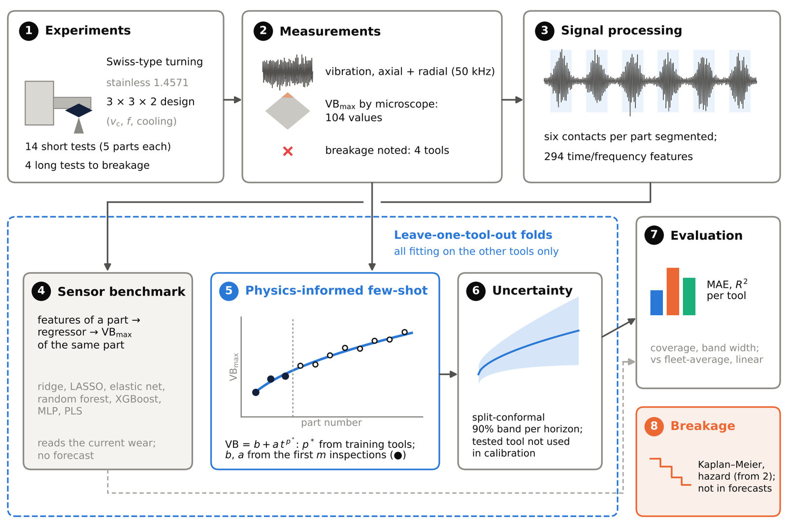
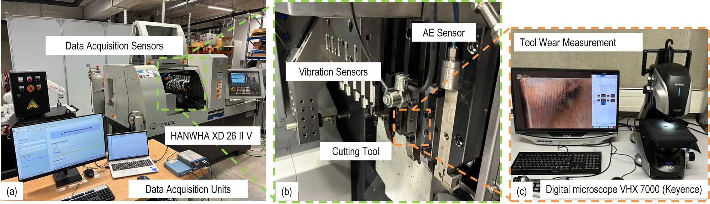
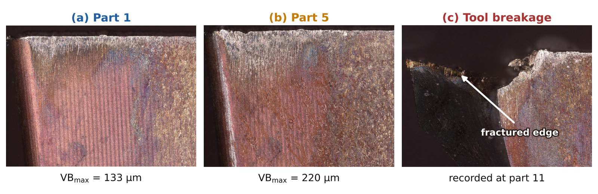
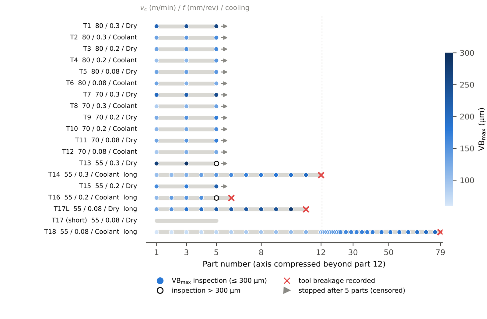
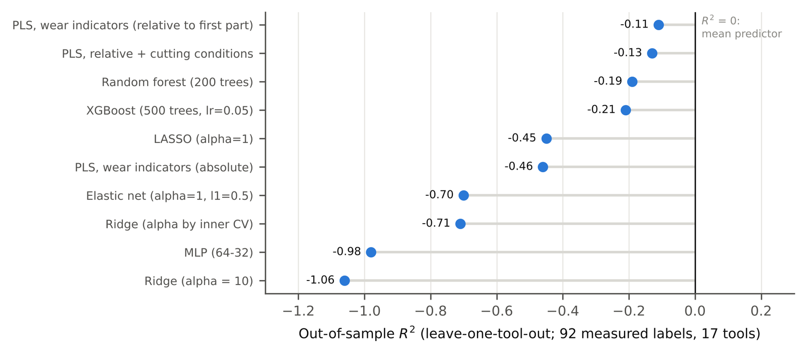
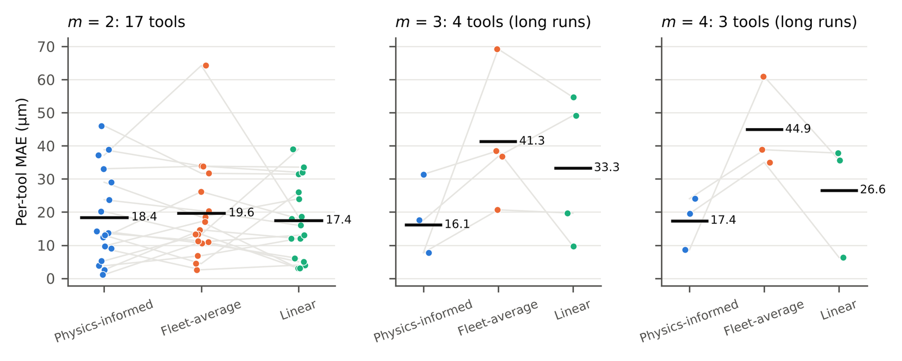
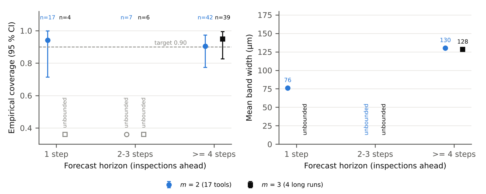
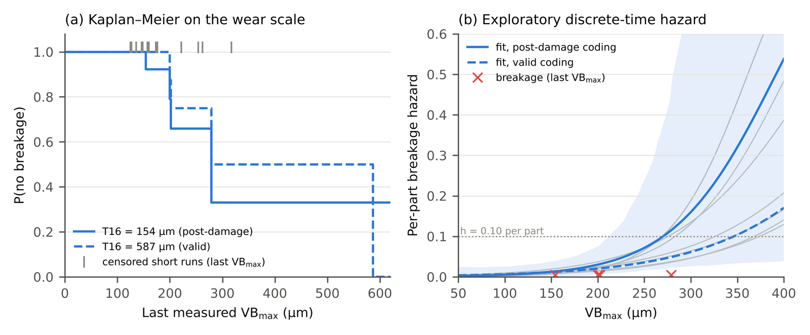
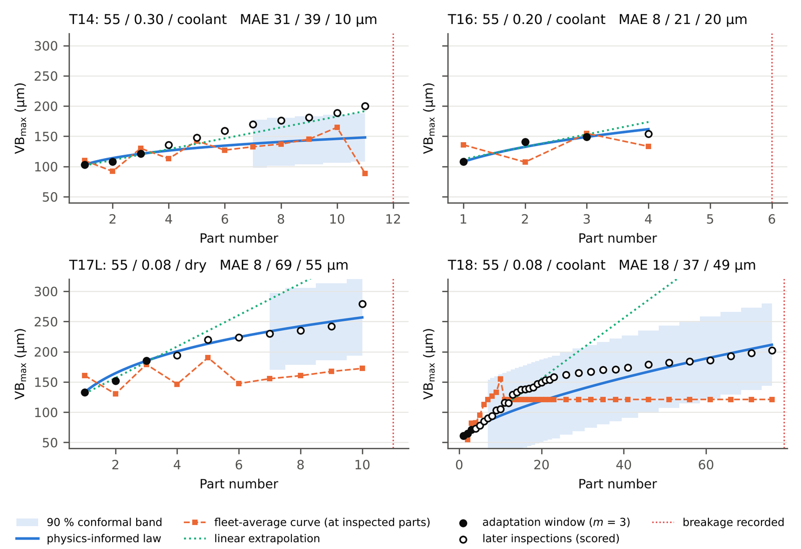

# Physics-Informed Few-Shot Flank-Wear Prediction from Sparse Inspections

[](requirements.txt)
[](LICENSE)
[-2E7D32)](#citation)

This repository holds the analysis code of the article *Physics-Informed Few-Shot Flank-Wear
Prediction from Sparse Inspections in Swiss-Type Turning of Stainless Steel*, accepted for
publication in *Machines* (MDPI), together with the documentation of the data behind it. Run in
order, the eight scripts in `analysis/` reproduce every result table and computed figure of the
article from the measured wear data.

<p align="center">
  
</p>
<p align="center"><sub><b>Overview of the study.</b> A 3 × 3 × 2 turning campaign with fourteen short
tests and four long tests run to breakage; a vibration-based benchmark and a physics-informed
few-shot model, each tested on tools it has never seen; uncertainty bands and breakage
evidence.</sub></p>

## Overview

Flank wear governs when a cutting tool must be replaced, and in production it is known only through
a handful of microscope inspections taken while the machine is stopped. This study asks how far
those sparse inspections can be extrapolated on a tool that the model has never seen, in Swiss-type
turning of 1.4571 stainless steel with coated-carbide inserts. The question is posed in the regime
that industrial campaigns actually produce: one tool per cutting condition, wear measured on a few
parts only, and an end of life that arrives as a sudden breakage rather than as a gradual wear-out.

The evidence comes from a full factorial campaign over cutting speed, feed and cooling, run once per
condition: fourteen short tests of five parts, with maximum flank wear VBmax measured on alternate
parts, and four long tests run until the tool broke, giving 104 measured VBmax values. Every model
is evaluated by leave-one-tool-out validation, in which each tool is predicted by a model
fitted on the other tools, and scored on measured values only. Three predictors are compared under that one
protocol: regressors trained on vibration features, a fleet-average wear curve, and a power law
whose shape is constrained to be concave. Each forecast is wrapped in a tool-grouped
cross-conformal band, a distribution-free interval whose coverage is calibrated on the errors made
on the other tools, and the four observed breakages are analysed separately with censoring.

The central result is that the constrained law extrapolates long trajectories from three
inspections with a mean absolute error of 16 µm, while the vibration-based regressors do not
transfer across tools at all. What makes the law work is not a governing wear equation but the
admissible shape it imposes: the training tools supply the exponent, and the tested tool supplies
only its own level and rate, so every forecast stays monotone and decelerating even when fitted to
two or three points. The limits of that result are reported alongside it, and are summarised below.

The material is arranged to be read from the experiments to the figures: `analysis/` holds the eight
scripts in the order of the article, `src/flankwear/` the wear-model functions they call, and
`data/` the inputs and their documentation. [Instructions for reproduction](#instructions-for-reproduction)
gives the commands, and [List of tables and figures](#list-of-tables-and-figures) maps every exhibit
of the article to the script that produces it.

## Summary of findings

| Research question | Finding |
|---|---|
| **RQ1.** Do regressors trained on vibration features predict VBmax on tools that were not used for training? | No. Out-of-sample R² lies between −1.06 and −0.11, with MAE between 38 and 53 µm, i.e. worse than predicting the average of the scored values. |
| **RQ2.** From the first m inspections of a new tool, how accurately does the wear law extrapolate the rest of its trajectory? | From three inspections, 16 µm mean absolute error on the long tests, against 41 µm for a fleet-average curve and 33 µm for linear extrapolation. Fitting a fixed exponent or a logarithmic law to the tool's own points already gives 20–27 µm, so most of the gain comes from the concave shape. With two inspections the law offers no advantage. |
| **RQ3.** What coverage and width do the conformal bands achieve? | Where the band is finite, 90–95% empirical coverage against a 90% target, at widths of 76–130 µm. At short horizons on the long tests too few calibration errors exist for a finite band. |
| **RQ4.** What do the observed breakages imply for a wear-based stop criterion? | Nothing conclusive. The four breakages followed last inspections of 154–279 µm, levels that several tools exceeded without failing, so they do not identify a threshold. |

An external check on the public PHM 2010 milling benchmark bounds the claim: where trajectories are
replicated and end in an accelerating stage, the law reduces to a straight line and the
fleet-average curve is the stronger competitor. The advantage reported here belongs to long,
decelerating trajectories observed in a sparse, single-replicate campaign.

## Experimental campaign

The campaign was machined on a Hanwha XD26II-V Swiss-type turning centre, whose sliding headstock
feeds the bar through a guide bushing so that cutting takes place in a short, stiff zone. Wear was
measured off the machine on a Keyence VHX-7000 digital microscope after selected parts, and axial
and radial vibration was recorded throughout at 50 kHz.

<p align="center">
  
</p>
<p align="center"><sub><b>Experimental setup.</b> (a) Hanwha XD26II-V Swiss-type CNC lathe with
data-acquisition units; (b) vibration and acoustic-emission sensor mounting at the cutting zone;
(c) VBmax measurement with a Keyence VHX-7000 digital microscope.</sub></p>

<p align="center">
  
</p>
<p align="center"><sub><b>One cutting edge (vc = 55 m/min, f = 0.08 mm/rev, dry) in its long test.</b>
(a) Part 1, VBmax = 133 µm; (b) part 5, VBmax = 220 µm; (c) tool breakage, recorded at part 11
(last inspection: 279 µm at part 10).</sub></p>

| Item | Specification |
|---|---|
| Process | Swiss-type turning (outer-diameter turning) |
| Machine | Hanwha XD26II-V |
| Workpiece / tool | Stainless steel 1.4571 (X6CrNiMoTi17-12-2) / VSP K2P coated-carbide insert |
| Depth of cut | ap = 2 mm |
| Design | Full factorial 3 × 3 × 2: vc ∈ {55, 70, 80} m/min; f ∈ {0.08, 0.20, 0.30} mm/rev; dry or coolant (18 conditions, 19 runs) |
| Test regimes | 14 short tests of 5 parts with VBmax on parts 1, 3 and 5 (plus one unmeasured repeat of 55/0.08/dry); 4 long tests run to tool breakage |
| Wear data | 104 measured VBmax values; 4 tool breakages; 14 runs stopped while still cutting |
| Sensors | Axial and radial vibration at 50 kHz; acoustic emission recorded, not modelled |

<p align="center">
  
</p>
<p align="center"><sub><b>Inspections and terminal events for all 19 runs of the design.</b> Each row
is one run; dots mark VBmax inspections coloured by wear (hollow: above the 300 µm analysis limit);
× marks a recorded tool breakage; arrows mark runs stopped after five parts.</sub></p>

## Method

Every model is fitted on the training tools alone and scored on the held-out tool, which contributes
only its first m measured inspections; every later inspection of that tool is used for scoring and
never for fitting. The exponent of the wear law, the fleet-average curve, the regressors with their
scaling, and the calibration errors of the bands are all recomputed inside each fold.

The physics-informed model is the power law $\mathrm{VB} = b + a\,t^{p^\ast}$, where t is the part
number within the run. The exponent $p^\ast$ is estimated once per fold across the training tools
and fixes the shape of the curve; the level $b$ and the rate $a$ are then fitted to the first $m$
inspections of the tested tool with a Theil–Sen line, the median of the pairwise slopes, which
limits the influence of a single off reading. Because the exponent lies between zero and one, the
forecast can only rise and only decelerate. No cutting parameter enters the law, so it transfers
neither a wear rate nor a condition between tools: the population supplies the shape, the tool its
own trajectory.

Two references are evaluated under the same protocol. The fleet-average curve predicts a new tool by
the mean trajectory of the training tools, and linear extrapolation continues the tool's own first
inspections in a straight line. The sensor benchmark represents the conventional data-driven route:
seven regressors on 294 vibration features plus cutting speed and feed, and a deliberately
favourable partial-least-squares baseline on 32 wear-sensitive indicators, each reading the signal
of a part to estimate the wear of that same part.

Uncertainty and end of life are treated separately. The conformal bands are calibrated per forecast
horizon on the errors of the other tools, grouped by tool and nested: the calibration tool and the
tested tool are both excluded from the fit that produces each error, and horizons with too few
errors are reported as unbounded rather than closed by assumption. Breakage is summarised by a Kaplan–Meier estimate on the
wear scale and by an exploratory discrete-time hazard, in both cases treating the tools that did not
break as censored at their last measured wear.

<table>
  <tr>
    <td width="50%"></td>
    <td width="50%"></td>
  </tr>
  <tr>
    <td><sub><b>Sensor benchmark.</b> Out-of-sample R² of the sensor-based regressors on 92 measured
    VBmax labels of 17 tools; R² &lt; 0 means less accurate than predicting the mean.</sub></td>
    <td><sub><b>Accuracy by inspection budget.</b> Per-tool MAE of each method for m = 2, 3 and 4;
    dots are tools, bars are means.</sub></td>
  </tr>
  <tr>
    <td></td>
    <td></td>
  </tr>
  <tr>
    <td><sub><b>Conformal bands by forecast horizon.</b> Empirical coverage against the 90% target
    and band width.</sub></td>
    <td><sub><b>Breakage evidence.</b> Kaplan–Meier estimate against the last measured VBmax, and the
    exploratory per-part breakage hazard.</sub></td>
  </tr>
</table>

## Results

Accuracy is reported as the mean of the per-tool MAE and as the pooled R², both computed on measured
VBmax values under leave-one-tool-out validation. The budget m is the number of early inspections
given to the model: m = 2 can be scored on 17 tools, m = 3 on the four long tests and m = 4 on three
of them, so the two regimes are reported separately and never averaged together.

| Method | m = 2 MAE | m = 2 R² | m = 3 MAE | m = 3 R² | m = 4 MAE | m = 4 R² |
|---|---:|---:|---:|---:|---:|---:|
| Fleet-average curve | 19.6 | 0.14 | 41.3 | −0.22 | 44.9 | −0.22 |
| Linear extrapolation | 17.4 | 0.06 | 33.3 | −1.85 | 26.6 | −0.60 |
| **Physics-informed, Theil–Sen (base model)** | **18.4** | **0.35** | **16.1** | **0.74** | **17.4** | **0.68** |
| Physics-informed, repeated median with local exponent (sensitivity) | 18.4 | 0.35 | 15.6 | 0.77 | 14.9 | 0.71 |

The separation appears only where the forecast has to reach far ahead. At m = 2, where every method
reduces to a two-point extrapolation two parts ahead, the three rows are within a few micrometres of
each other, a difference comparable to the repeatability of the wear measurement itself. At m ≥ 3,
on trajectories of tens of parts, linear extrapolation overshoots and the fleet-average curve
inherits the level and the inspection grid of other tools, while the constrained law stays within
16 µm of the measured wear.

<p align="center">
  
</p>
<p align="center"><sub><b>Forecasts for the four long tests from their first three inspections.</b>
Filled dots: inspections given to the model; open dots: later inspections used for scoring. The MAE
of the physics-informed law, the fleet-average curve and linear extrapolation is given in each
title.</sub></p>

## Equipment, methods and software

### Laboratory equipment

| Purpose | Equipment |
|---|---|
| Machining | Hanwha XD26II-V Swiss-type turning centre, sliding headstock with guide bushing |
| Workpiece and insert | Stainless steel 1.4571 (X6CrNiMoTi17-12-2); VSP K2P coated-carbide insert |
| Wear measurement | Keyence VHX-7000 digital microscope, VBmax measured off the machine after selected parts |
| Process signals | Piezoelectric accelerometers in the axial and radial directions, sampled at 50 kHz, with the data-acquisition units shown in the setup figure |
| Also instrumented | An acoustic-emission channel, recorded but not used for modelling |

### Analysis methods

| Step | Methods |
|---|---|
| Validation | Leave-one-tool-out cross-validation, with every fitted quantity recomputed without the held-out tool |
| Signal description | Time-, frequency- and time–frequency-domain features of each tool–workpiece contact, aggregated over the six contacts of a part, giving 294 features |
| Sensor benchmark | Ridge regression, the LASSO, elastic net, random forest, gradient-boosted trees, ridge regression with a cross-validated penalty, a multilayer perceptron with 64 and 32 units, and partial least squares on 32 wear-sensitive indicators |
| Wear-curve fitting | Theil–Sen estimator, Siegel repeated median as a sensitivity check, ordinary least squares, and a grid search for the shared exponent |
| Uncertainty | Tool-grouped cross-conformal prediction bands (nested leave-one-tool-out), with Clopper–Pearson intervals for the measured coverage |
| Breakage | Kaplan–Meier estimate, discrete-time hazard by maximum likelihood with a Firth-penalised check, profile-likelihood intervals, refits leaving out one breakage at a time, and a bootstrap over tools |
| External check | The public PHM 2010 milling benchmark, three labelled cutters measured after each of 315 cuts |

### Software environment

| Library | Used for |
|---|---|
| numpy, pandas | Arrays, tables and the dataset ledger |
| scipy | Optimisation, curve evaluation and statistical functions |
| scikit-learn | The regressors, partial least squares, scaling and the inner validation loops |
| xgboost | The gradient-boosted-tree regressor |
| matplotlib | Every figure of the article |
| openpyxl | Reading the design-of-experiments workbook |
| Pillow | Assembling the micrograph panel |

## Repository layout

```
.
├── analysis/                  analysis scripts, run in numerical order
│   ├── 01_build_ledger.py         dataset ledger from the DOE workbook
│   ├── 02_sensor_regression.py    sensor benchmark
│   ├── 03_fewshot_accuracy.py     few-shot accuracy and conformal bands
│   ├── 04_robustness.py           robustness variants
│   ├── 05_breakage_hazard.py      breakage hazard
│   ├── 06_hazard_bands.py         bootstrap bands of the hazard
│   ├── 07_figures.py              Figures 2-9
│   └── 08_phm2010_check.py        external check on public data
├── src/flankwear/             wear-model functions used by the scripts
├── data/                      inputs (see data/README.md)
├── docs/figures/              figures shown in this README
├── run_all.py                 runs the whole analysis
├── requirements.txt
├── CITATION.cff
└── LICENSE
```

## Data availability and provenance

The wear data analysed in the article were produced by the authors in the campaign described above
and are available from the authors on reasonable request, subject to laboratory restrictions. They
are not redistributed here: `data/` contains the index that links each workpiece to its run, which
carries no measurements, and [data/README.md](data/README.md) names the files to place beside it,
their columns and the scripts that read them.

The external check uses the public milling data of the
[2010 PHM Society Conference Data Challenge](https://phmsociety.org/phm_competition/2010-phm-society-conference-data-challenge/),
redistributed here as a single table of the labelled cutters. Nothing from that benchmark enters any
result of the main article.

## Computational requirements

The analysis runs on a standard desktop computer with Python 3.10 or newer and the packages pinned
in [requirements.txt](requirements.txt); no GPU is required. A complete run takes about three
minutes, of which the sensor benchmark and the robustness variants account for most. Every random
component — the gradient-boosted trees, the random forest, the multilayer perceptron and the
bootstrap over tools — is seeded in the scripts, so repeated runs return identical values.

## Instructions for reproduction

```bash
git clone https://github.com/sudomanuel/few-shot-flank-wear-prediction.git
cd few-shot-flank-wear-prediction
python -m venv .venv
source .venv/bin/activate          # Windows: .venv\Scripts\activate
pip install -r requirements.txt
python run_all.py
```

`run_all.py` executes the scripts in order and reports the state of each one. Results are written to
`out/results/` as CSV files and figures to `out/figures/`. Without the wear data, only the external
check on the public benchmark is run; the scripts that need the campaign are skipped with a message
naming the missing file. Individual steps can also be run on their own, in numerical order, since
each script reads the outputs of the previous ones.

## List of tables and figures

| Script | Output | In the article |
|---|---|---|
| `01_build_ledger.py` | `doe_records.csv`, `doe_tools.csv` | Table 2, Figure 3 |
| `02_sensor_regression.py` | `sensor_regression.csv` | Figure 5, Section 3.3 (cooling indicator) |
| `03_fewshot_accuracy.py` | `fewshot_doe_summary.csv`, `fewshot_doe_pertool.csv`, `fewshot_doe_conformal.csv` | Table 3, Figures 6 and 7 |
| `04_robustness.py` | `ablation.csv`, `negative_rate.csv`, `conformal_nested.csv`, `cutoff_sensitivity.csv` | Table 4, Figure 8, Section 4.4 (the bands reported there are the nested rows) |
| `05_breakage_hazard.py` | `hazard_doe_fits.csv`, `hazard_doe_loo.csv`; bootstrap printed to the console | Section 4.5 |
| `06_hazard_bands.py` | `hazard_bands.csv` | Figure 9 |
| `07_figures.py` | `Fig2_micrographs.png` to `Fig9_breakage_evidence.png` | Figures 2 to 9 |
| `08_phm2010_check.py` | `phm2010_base.csv` | Appendix A, Table 5 |

Figure 1 of the article is a photograph of the experimental setup and is not produced by the code.
Figure 2 is assembled by `07_figures.py` from the micrographs listed in
[data/README.md](data/README.md).

## Citation

If you use this code, please cite the article (full reference to be added on publication):

```bibtex
@article{pusma2026fewshot,
  title   = {Physics-Informed Few-Shot Flank-Wear Prediction from Sparse Inspections in
             Swiss-Type Turning of Stainless Steel},
  author  = {Pusma Jurado, Manuel Inocencio and Fattahi, Saman and Schnell, Josef and
             Ahmadpoor, Seyyed Sajjad and Alinaghizadeh, Amir and Azarhoushang, Bahman},
  journal = {Machines},
  year    = {2026},
  note    = {Accepted for publication}
}
```

## Author

Manuel Inocencio Pusma Jurado<sup>1,2</sup> — code, analysis and computed figures in this
repository.

<sup>1</sup> KSF Institute for Advanced Manufacturing, Furtwangen University, Tuttlingen, Germany<br>
<sup>2</sup> Faculty of Electrical and Electronic Engineering, Universidad Nacional de Ingeniería, Lima, Peru

The article is co-authored; its full author list is in the citation above. The photograph of the
experimental setup and the micrographs shown here were produced in the laboratory and are
reproduced from the article.

## Acknowledgements

This research was funded by the Ministry of Economic Affairs, Labour and Tourism Baden-Württemberg
within the innovation funding programme Invest BW, project KryoDreh. The authors thank HB TURNKEY GmbH
for providing the Hanwha XD26II-V Swiss-type turning centre.

## License

Released under the [MIT License](LICENSE).
